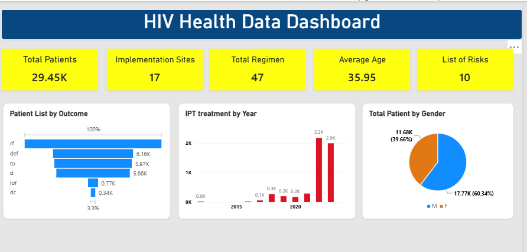
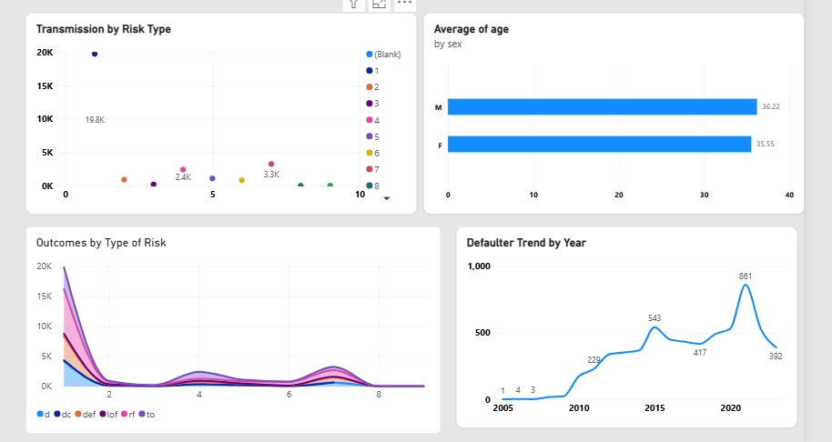

# Health_Data_Dashboard

HIV dashboard , source from Inspired Dummy Data

## Project

## Project Description
This image depicts about the cases of HIV in seven implementation sites with Average age, total regimen which are used to take the treatment on patients. 
In terms of gender, male experienced more than female and Risk type 1 has by far the highest transmission type among other types.
